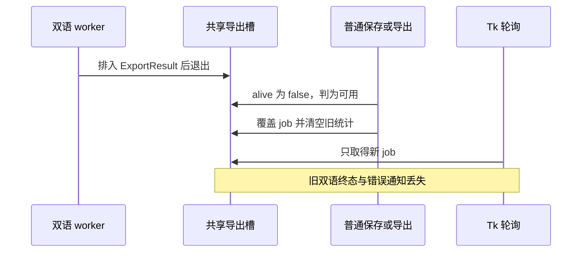
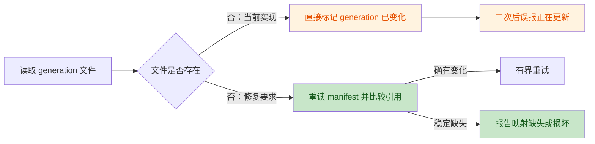

# 双语 EPUB 导出验收记录

验收日期：2026-11-20。基准：当前未提交工作区，架构规格为 `docs/BILINGUAL_EPUB_EXPORT_ARCHITECTURE.md`。

结论：**初审发现的两项代码缺陷均已修复，相关自动化复验通过；真机阅读器验收仍待完成。** 用户已授权修复全部问题，本次在初审基础上修改共享导出槽和只读映射快照逻辑，补充确定性回归测试。尚不能标记为包含阅读器人工检查在内的全部验收完成。

## 初审确认问题（现已修复）

| 编号 | 优先级 | 初审问题 | 代码位置 | 修复状态 |
| --- | --- | --- | --- | --- |
| 1 | P2 | 未消费的双语导出终态能被普通保存/导出覆盖，丢失成功或失败通知及双语统计。 | `src/ui/translation_controller.py` 的 `_export_is_running()`、`_start_text_export()`、`export_epub_file()` | 已统一按终态消费前持续占用判断，并补上保存对话框返回后的检查。 |
| 2 | P3 | 稳定 manifest 指向永久缺失文件时，误报“项目映射正在更新，请稍后重新导出”。 | `src/infrastructure/mapping_repository.py` 的 `read_content_mapping_snapshot()` | 已在文件缺失后重读并比较 manifest；稳定缺失立即报映射错误，引用变化才有界重试。 |

两项均已用额外样例复现，且由审查技能要求的两位复核代理确认。

以下两节保留初审时的缺陷说明、复现与修复要求，所述旧行为已由本次修复替换。初审行号对应修复前工作区。

### 1. 任务槽释放规则不统一

新双语入口在 `1979–1981` 用 `_export_job is not None` 拒绝占用，符合规格。但普通保存、TXT 对照导出使用 `_export_is_running()`（`1859–1860`），普通 EPUB 在 `1911–1916` 也只检查线程是否仍然运行。

worker 可以已经将成功/失败的 ExportResult 放入队列并退出，而下一次 Tk 轮询尚未发生。此时用户触发普通保存/导出会获准启动，`_start_text_export()` 替换旧 job，同时清空双语 session/report。轮询再也读不到旧结果；旧任务失败也不能通知用户。这个问题不意味着已生成的 EPUB 内容损坏，但破坏了任务终态与失败可见性。

复现方式：构造 `is_running=False`、仍有未消费终态的旧 job，将其设置给真实 controller；仅替换保存对话框和实际文件写出，调用真实 `export_comparison()`。观察到旧 job 被覆盖、双语 session 和统计队列被清空。不是仅凭代码推测竞态。

修复范围应局限于共享导出槽：统一异步入口占用检查，并在设置新 job 前二次检查。不要为此改变同步保存、自动保存或翻译管线。新增回归需模拟“线程退出但终态尚未轮询”的确定性窗口。

### 2. 稳定缺失被误判为并发更新

只要 generation 文件读取产生 FileNotFoundError，当前代码就直接设置 `generation_changed=True`，没有证明 manifest 发生变化。经过三次尝试后，永久缺失也成为 Busy 错误。

复现方式：创建固定 `generation="stable-g1"` 的 manifest，令其指向不存在的 `.mapping_generations/stable-g1/content_mapping.json`，随后调用 `read_content_mapping_snapshot()`。实际抛出 `MappingSnapshotBusyError`。等待不会修复这个项目，却被提示继续稍后重试。

这与架构文档 §6.2 的“稳定引用下持久缺失应为映射错误”不符。现有新增测试验证了“无 manifest 的旧文件缺失”，仍未覆盖此分支。

## 架构核对结果

| 项目 | 验收结果 |
| --- | --- |
| 导出阶段新增双语模式，翻译请求、缓存、提示词及行号协议保持 | 已核对相关差异，未发现本功能改动翻译链路。 |
| 主线程提交编辑、不可变快照、过滤与流式预览隔离 | 实现及相关测试通过。 |
| worker 加载图片记录，内存叠加译文，不保存映射 | 实现及相关测试通过。 |
| 旧四参数门面与普通 EPUB 默认路径 | 兼容分支和回归测试通过。 |
| 段落定位、重复原文、空译文不移位、原文编辑拒绝 | 相关单元和集成测试通过。 |
| 原文内联格式、列表、标题、caption、图片保留 | 已检查渲染分支与相关测试；真实阅读器显示仍待验收。 |
| generation 稳定读取及错误分类 | 已补齐稳定 manifest 缺文件错误分类、引用变化重试和重试上限测试。 |
| 会话切换与任务终态隔离 | 会话隔离及共享任务槽回归通过，覆盖线程退出后未消费的成功/失败终态。 |
| 临时文件、验证、备份与原子发布 | 复用现有机制，相关测试通过。 |
| 真机阅读器：主题、长段分页、目录、图片页 | 本次未执行，不能据结构测试判定通过。 |

按用户界定，`atomic_file.py`、`test_atomic_file.py` 的已有改动不计入本次功能评审结论；前一轮已有字数统计相关改动也不作为双语功能新增要求。

## 初审实际运行结果（修复前，保留历史）

环境：项目 `.venv`，Python 3.14.5。本记录不把开发方提供的其他 Python 版本结果冒充为本轮重跑结果。

| 检查 | 本轮结果 |
| --- | --- |
| 双语及相关回归测试：renderer、epub、snapshot、export job/helper、mapping、EPUB 修复、dirty、图片流程 | **224 passed**。 |
| `ruff check .` | **All checks passed**。 |
| `ruff format --check .` | **200 files already formatted**。 |
| `pyright --pythonversion 3.12 --pythonplatform Linux` | **0 errors, 0 warnings**。这是静态检查目标，不表示运行时使用了 Python 3.12。 |
| `compileall -q main.py build.py src tests tools` | 退出码 0。 |
| 全量 `pytest -q` | **1532 passed, 1 failed**，82.16 秒。 |
| 单独重跑失败所在文件 `tests/test_ui_callback_mailbox.py` | **27 passed**，0.16 秒。 |

全量失败项为 `TestPumpErrorHandling.test_callback_exception_does_not_crash_pump`，与开发方报告的 Tcl 初始化问题不同。该测试假设一次 poll 必须执行第三个回调；实际事件泵具有单帧时间预算，达到预算会把后续回调延后。相关实现与测试不属于本次改动，单独重跑通过，因此本次不将其列为双语功能回归，也不把这次全量结果报告成全绿。

本轮没有重跑 Python 3.10/3.12/3.13 的多版本全量矩阵，没有执行桌面/移动阅读器人工检查、纵排/RTL/固定布局显示验收或打包后的可执行文件验收。

## 修复内容与复验

1. 共享导出槽以 `_export_job is not None` 为占用依据。TXT 保存、TXT 对照、普通 EPUB 和双语 EPUB 均保留旧终态、会话和统计，直至轮询处理完毕。`_start_text_export()` 在设置任务前再次检查占用并返回是否启动；异步保存直接返回该结果。普通 EPUB 在保存对话框返回后再次检查，运行中任务的取消入口保留。
2. 映射成员缺失后重读 manifest，稳定引用抛 `MappingSnapshotError`，不读取旧兼容副本；manifest 变化才重试。读取成功后也比较完整 manifest，避免同 generation 标识下引用变化漏检。

新增 16 个回归用例，覆盖四个导出入口的未消费成功/失败终态、三个普通入口在模态对话框期间被占用、普通 EPUB 的运行中取消、稳定发布引用缺文件、同 generation 的引用切换（旧文件存在/缺失），以及缺文件且持续切换时的重试上限。

修复后实际运行结果（2026-11-20，项目 `.venv` Python 3.14.5）：

| 检查 | 复验结果 |
| --- | --- |
| 双语及相关回归测试（与初审相同的 11 个测试文件） | **240 passed**，10.21 秒。 |
| 全量 `pytest -q` | **1549 passed**，76.96 秒。修复后的全量检查一次通过。 |
| `ruff check .` | **All checks passed**。 |
| `ruff format --check .` | **200 files already formatted**。 |
| `pyright --pythonversion 3.12 --pythonplatform Linux` | **0 errors, 0 warnings**。 |
| `compileall -q main.py build.py src tests tools` | 退出码 0。 |

本次修复仅涉及两个业务文件及两个双语回归测试文件；同步保存、自动保存及翻译管线保持现有实现。未重新执行多 Python 版本矩阵或阅读器人工检查。初审的全量失败记录保留于上一节，本次全量通过不抹去该历史结果。

## 建议验收口径

当前可以标记为“代码问题已修复，相关自动化检查通过，待阅读器人工验收”。

正式标记“按文档全部完成”前，仍需记录桌面/移动阅读器的逐段上下对照、夜间主题、长段分页、目录跳转、图片页无空白页，以及标题内嵌 fallback 字体大小的人工检查结果。纵排、RTL、固定布局不承诺自动重排。全量既有计时波动按上述历史结果保留。
