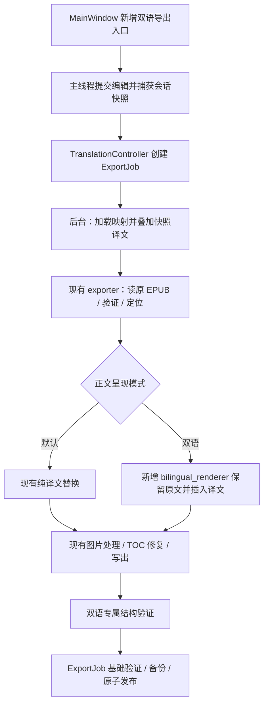

# 双语对照 EPUB 导出架构与开发交接文档

日期：2026-11-20。项目声明版本：1.6.2。调研基准：当前工作区，Git HEAD `1d2dc6a`。

交付性质：本文是实现规格，尚未实现功能。用户已确认采用 **EPUB 内逐段“原文在上、译文在下”** 的排版。

编写时工作区已有 `src/ui/main_window.py`、`src/ui/translation_table_adapter.py` 的未提交修改。开发 AI 必须以实施时的实际文件为准，保留已有修改；本文中的符号比行号更可靠。

## 1. 目标、范围与架构决定

在现有“导出 EPUB”旁新增“导出双语 EPUB”。同一份翻译结果可以分别导出纯译文 EPUB 和双语 EPUB，无须重新翻译。

核心决定：**双语对照是导出时的呈现方式，不是新的翻译模式，也不是新的项目存储格式。**

现有管线保持：

```text
导入 → 原文段落映射 → 普通/超长/逐行翻译 → 结果提交 → 人工编辑/自动保存
                                                        │
                          ┌─────────────────────────────┼─────────────────────┐
                          ▼                             ▼                     ▼
                    现有 TXT 对照                  现有纯译文 EPUB       新增双语 EPUB
                                                                          │
                                                           原文节点 + 对应译文节点
```

这里“不改变现有管线”允许新增菜单、导出数据契约、可选参数及双语渲染分支；不允许重构翻译链路、改变既有默认行为或把双语字符串回灌到译文数据中。

本期范围：

- 主界面新增双语 EPUB 导出入口，只支持已有 EPUB 映射的会话。
- 按现有段落映射对齐，保留章节、目录、原文锚点、原文内联格式和资源。
- 复用现有图片替换与图片文字注释能力；正文双语不代表图片也并排展示两份。
- 支持部分翻译完成的文档：有译文的段落生成对照；无译文的段落仅保留原文。
- 不新增运行依赖，不迁移历史项目，不新增 API 请求。

本期不扩展：左右并排、句级自动对齐、PDF/DOCX/HTML 独立导出、TXT 转 EPUB、双语编辑器、双语目录、批量双语导出、译文内联格式自动对齐。已有 TXT“导出对照文件”继续保留。

批量双语是后续独立增量，不应成为本期验收前提；第 12 节给出接入约束。

## 2. 已核实的代码现状

| 区域 | 文件与符号 | 本功能需要利用或注意的事实 |
| --- | --- | --- |
| 文档数据 | `src/application/translation_document.py`：`TranslationDocument` | 文档模型是业务状态来源；`source_lines()`、`target_lines()` 返回副本；`version` 随修改递增。原文实际上也可通过 `update_source()` 编辑。 |
| 会话 | `src/application/document_session.py`：`DocumentSession` | 包含 `session_id`、`kind`、源/目标路径、`mapping_dir` 和文档；必须捕获同一会话的数据。 |
| 表格数据入口 | `src/ui/main_window.py`：`get_table_data()` | 当前从文档模型取原文和译文，不遍历 Treeview。新入口应继续使用模型，避免过滤或流式预览影响导出。 |
| 内联编辑 | `src/ui/table_editor.py`：`TableCellEditor.save()` | 未提交的 Entry 编辑尚未进入模型；导出捕获前须在主线程提交当前编辑。主窗口实例为 `_cell_editor`。 |
| 已有对照导出 | `src/ui/translation_controller.py`：`export_comparison()`；`src/utils/file_handler.py`：`create_comparison_file()` | 已有逐行 TXT 原译文对照，通过 `TextExportJob` 后台写入。不能把本需求误判为从零开发 TXT 对照。 |
| 主窗口导出入口 | `src/ui/main_window.py`：文件菜单、更多操作菜单、`refresh_action_state()` | 已有“导出 EPUB”，按 EPUB 会话启用；新增入口要在这些位置保持一致。 |
| EPUB 导出协调 | `src/ui/translation_controller.py`：`export_epub_file()` | 捕获译文后用 `ExportJob` 执行；先调用 `save_translations()` 写映射，再从映射导出。新增路径不能照搬这一回写步骤。 |
| 后台原子发布 | `src/application/export_job.py`：`ExportJob` | 临时文件、阶段事件、ZIP 基础校验、覆盖前备份、`os.replace`，失败或取消清理临时文件。 |
| 兼容门面 | `src/core/epub_processor.py`：`EpubProcessor.export_epub()` | 当前四个位置参数，委托 `src/infrastructure/exporter.py`；既有调用必须兼容。 |
| EPUB 重建 | `src/infrastructure/exporter.py`：`export_epub()` | 读取原 EPUB、验证指纹、按 spine 遍历、双解析器校验、映射定位、替换正文、处理图片、写出。适合增加局部呈现分支。 |
| 原有替换器 | 同上：`_replace_text_preserving_inline()` | 用译文替换原节点中的文本；只适用于现有纯译文模式，双语模式不能调用它修改原文。 |
| 稳定定位 | `src/infrastructure/segment_extractor.py` | `chapter_id + block_index + source_checksum`；原文校验和基于提取后的段落文本。`BLOCK_TAGS` 与导出共用。 |
| 映射格式 | `src/infrastructure/mapping_repository.py` | 原文/译文按 `line_number` 对齐；有 generation manifest 和旧顶层兼容副本，读取须用 `resolve_mapping_file()`。 |
| 映射并发 | 同上：`publish_mapping_file_update()`、generation GC | 保存会发布新 generation 并回收不可达目录。只捕获一个 generation 文件路径，不能保证稍后还能打开它。 |
| 章节顺序 | `src/infrastructure/document_order.py`：`iter_spine_documents()` | 导入/导出共享正文遍历与路径归一化规则，不能自行换成所有 HTML 文件的字典顺序。 |
| XHTML 保真 | `src/infrastructure/image_rewriter.py`：`get_document_content()`、`set_document_content()` | 直接保留原始文档头、样式、body 属性和 SVG 大小写属性；不要退回 ebooklib 的章节模板重建方式。 |
| 图片与注释 | 同上：`add_translated_images()`、`inject_figcaption()` | 已处理资源路径、封面与纯图片页等特殊行为；不要为正文双语再造一套图片逻辑。 |
| 批量导出 | `src/ui/concurrent_window.py`：`_export_all()` | 独立于主界面 controller；默认只导出 completed 任务，直接使用磁盘映射。只改主界面不会自动覆盖批量。 |

两项既有修复必须保留：导出器会给每次输出生成独立标识，并处理单页分页属性；同时通过 `_ensure_toc_link_ids()` 修复 TOC 链接标识。新模式也要经过这些步骤。

## 3. 必须保持的不变量

1. 不修改 `translator.py`、provider、提示词、缓存键、超长上下文策略、补漏机制及行号协议。
2. 不把“原文 + 译文”写入 `TranslationRow.target`、项目快照或 `content_mapping.json.translated_text`。
3. 不改 `BLOCK_TAGS`、`is_leaf_block()` 或导入段落提取规则来适配新增节点。
4. 不修改 mapping schema、manifest schema、已有项目字段及自动保存语义。
5. 双语导出不调用 `save_translations()`，不触发人工保存，不清除 dirty，不修改 `target_path`，不调用 `_on_save_success()`。
6. 双语导出使用捕获时已提交的结果，保留人工译文；不读取 Treeview 中尚未提交的流式预览。
7. 普通 EPUB 不传新选项时仍走原有呈现逻辑；已有 TXT 对照及批量“一键导出”语义保持。
8. 原 EPUB、现有译文及项目数据不得被导出目标覆盖；失败或取消不得发布半成品。

以上第 5 条约束的是双语导出的副作用。提交当前 Entry 编辑引发的正常自动保存，仍按现有行为进行，不能为了让磁盘“完全不变化”而禁用自动保存。

## 4. 分层与模块边界

采用“不可变文档快照 + 导出选项 + 局部 DOM 渲染器”。不复制整个 `exporter.py`，不新增第二套 EPUB 解析与重建管线。



图中的双语结构验证只在新模式执行。普通导出仍复用其既有验证步骤。

| 文件 | 变更性质 | 职责 |
| --- | --- | --- |
| `src/domain/epub_export.py` | 新增 | 模式、选项、不可变文档快照和结果统计；仅标准库类型。 |
| `src/infrastructure/bilingual_renderer.py` | 新增 | 对已定位节点插入译文、注入局部 CSS、维护本次插入统计；不读项目、不访问 UI。 |
| `src/infrastructure/bilingual_validation.py` | 新增 | 校验写出后的双语 XHTML、CSS 引用及预期译文数量；不负责发布。 |
| `src/infrastructure/exporter.py` | 小范围修改 | 增加快照输入与模式分支，复用原有指纹、定位、图片及写出逻辑。 |
| `src/infrastructure/mapping_repository.py` | 增加只读函数 | 稳定读取一份已发布 content mapping；不改保存协议。 |
| `src/core/epub_processor.py` | 兼容扩展 | 将新增可选参数转交底层，保留原四参数调用。 |
| `src/application/export_job.py` | 小范围修改 | 允许省略 `save_mapping` 回调，跳过对应阶段；其他行为不变。 |
| `src/ui/main_window.py` | 小范围修改 | 新增菜单项、启用状态和主线程快照回调。 |
| `src/ui/translation_controller.py` | 新增方法与少量接线 | 新增 `export_bilingual_epub_file()`，接入既有 job/轮询，隔离导出会话上下文。 |
| `src/ui/export_helpers.py` | 增加纯函数 | 默认文件名 `书名_双语对照.epub`；不得改变现有默认文件名函数。 |
| `tests/` | 新增与补充 | 按第 13 节验证新行为及旧行为兼容性。 |

不要求增加新的应用服务框架或通用插件系统。现有 `ExportJob` 的 callable 注入已足够表达编排，application/domain 不应反向导入 infrastructure 或 Tk。

## 5. 数据与接口契约

### 5.1 新增类型

下列签名是建议实现契约，不是现有代码。Python 3.10 兼容，不使用 `StrEnum`。

```python
from dataclasses import dataclass
from enum import Enum
from pathlib import Path


class EpubTextMode(str, Enum):
    TRANSLATED = "translated"
    BILINGUAL = "bilingual"


@dataclass(frozen=True, slots=True)
class EpubExportOptions:
    text_mode: EpubTextMode = EpubTextMode.TRANSLATED
    target_language_tag: str | None = None


@dataclass(frozen=True, slots=True)
class EpubDocumentSnapshot:
    session_id: str
    document_version: int
    source_path: Path
    mapping_dir: Path
    source_lines: tuple[str, ...]
    target_lines: tuple[str, ...]


@dataclass(frozen=True, slots=True)
class BilingualExportReport:
    total_segments: int
    paired_segments: int
    untranslated_segments: int
    preserved_segments: int
```

`frozen=True` 只冻结字段；字段内也要使用 tuple、字符串等不可变值，不能塞入可变 list/dict。图片映射在 worker 准备阶段加载成私有副本，不把 UI 的可变字典传到后台。

`session_id + document_version` 标识捕获点，不表示磁盘保存版本。后台不能拿着 `TranslationDocument` 或 `DocumentSession` 对象继续读取。

统计满足 `total_segments = paired_segments + untranslated_segments + preserved_segments`：先把不参与双语呈现的纯图片页/明确不可见节点计入 preserved，其余有译文计入 paired、缺译文计入 untranslated。每条映射只进入一种结果。

### 5.2 导出器兼容扩展

门面与底层都保留原四个参数，在末尾增加 keyword-only 参数：

```python
def export_epub(
    mapping_dir: str,
    output_path: str,
    image_map: dict[str, str] | None = None,
    image_text_map: dict[str, dict[str, object]] | None = None,
    *,
    options: EpubExportOptions | None = None,
    snapshot: EpubDocumentSnapshot | None = None,
    on_report: Callable[[BilingualExportReport], None] | None = None,
) -> str:
    ...
```

约束：

- `options is None` 等价于现有纯译文模式，无新增 CSS、双语标记或双语校验。
- 新双语入口必须传 `BILINGUAL` 和非空 `snapshot`；缺少快照直接报错，不能静默读取磁盘旧译文。
- 第一版只在双语模式接受 `snapshot`；纯译文模式带 snapshot 应明确拒绝，避免引入尚未定义的行为。
- 无新增参数的门面调用仍可按原四参数方式委托，兼容现有 mock、monkeypatch 与调用方。
- `mapping_dir` 必须与快照中的目录一致；源路径必须与映射 `project_info.original_file` 一致，不能拼接其他项目的数据。
- 函数返回实际写入路径，继续满足 `ExportJob` 对临时输出路径的检查。
- `Callable` 从 `collections.abc` 导入。`on_report` 仅在双语模式的临时文件通过增强校验后调用一次，传递不可变统计；它不能调用 Tk。controller 使用本次 job 私有的 `queue.SimpleQueue` 接收统计，在 `ExportResult.succeeded` 时读取并显示；后续备份/发布失败或取消时丢弃统计，不显示导出成功。无需改变 `ExportResult` 返回类型。

### 5.3 主线程快照回调

由 MainWindow 提供 `capture_epub_export_snapshot()`，通过 controller 构造函数末尾新增的可选回调注入，旧构造方式保持兼容。该回调依次执行：

1. 调用 `_cell_editor.save()` 提交正在编辑的单元格。
2. 通过现有 `file_importer.session` 属性读取 `DocumentSession` 的会话、路径及 `document`，不新增全局会话变量。
3. 验证是 EPUB 会话且有原文件和映射目录。
4. 一次性构造原文 tuple、译文 tuple，并记录 `session_id` 和 `document.version`。

全部发生在同一个 Tk 回调内，不插入 `update()` 或分块 `after()`；禁止捕获一半原文后让事件泵更新译文，再捕获另一半。

新入口若缺少快照回调，应显示明确错误；不能退回读取表格或无会话校验的磁盘数据。

## 6. 映射快照、对齐与并发

### 6.1 为什么不能“先保存译文，再双语导出”

现有普通 EPUB 导出采用先写映射、再重建的路径。新功能如果照搬，导出和自动保存可能相互覆盖；导出取消也可能已经改写映射。第一版采用只读映射 + 内存覆盖，避免新功能增加项目写入者。

### 6.2 一次稳定读取，不持有 generation 路径

在 mapping repository 新增只读函数，例如 `read_content_mapping_snapshot(mapping_dir) -> dict`：

1. 读取 manifest 的当前标识；没有 manifest 时按已有旧格式规则处理。
2. 用 `resolve_mapping_file()` 获取本次发布的 content 路径，并立即读取完整内容到内存。
3. 再读 manifest；若读取期间发布发生变化，丢弃本次内容并重新尝试。
4. 遇到并发 GC 引起的 `FileNotFoundError` 时重新读取 manifest 和文件；最多 3 次，不无限等待。
5. manifest 损坏、字段非法或 JSON 损坏须明确失败；不得回退到顶层兼容副本混读。
6. 达到次数后提示“项目映射正在更新，请稍后重新导出”，不阻塞或暂停现有自动保存。

重试仅针对明确的 generation 变化/文件被回收。稳定 manifest 下的持久缺失、损坏仍按映射错误处理。旧格式单文件读取继续依赖现有原子替换，成功解析后便拥有私有内存对象。

本功能只需要 content mapping；不要为了获得“全量快照”反复打开不需要的 `images.json`、`format_info.json`。图片导出记录分别按现有 helper 加载一次，作为本次导出的固定副本。

### 6.3 内存覆盖规则

读取映射后，在 exporter 的私有内存对象中执行：

```text
严格验证 line_number 是无重复的整数，按 1..N 连续排列
要求 mapping 记录数 == 快照原文数 == 快照译文数
第 i 条记录的 line_number 必须为 i + 1
快照 source_lines[i].strip() 必须等于记录 original_text.strip()
将记录 translated_text 设为快照 target_lines[i]，仅修改内存
继续使用原 chapter_id / block_index / source_checksum 做 DOM 定位
```

不得先过滤空译文再 zip，也不得用原文字符串作为唯一键：同一章节或不同章节可以重复出现完全相同的原文。

界面允许编辑原文，但原 EPUB 和定位校验仍以导入时原文为准。本期若检测到界面原文与映射原文不同，拒绝双语 EPUB，指出行号并说明“当前原文已编辑，与 EPUB 映射不一致；可使用现有 TXT 对照导出保存编辑内容”。不得静默忽略编辑，也不得自动重导入而丢失译文。

### 6.4 文件与节点的验证顺序

1. 验证快照、映射和项目路径关系。
2. 继续调用现有 `_verify_source_fingerprint()`；存在内容哈希时严格验证。
3. 按现有 spine 与解析器规则，生成固定的 `mapping_blocks`、`output_blocks` 列表。
4. 保留 `_validate_chapter_records()` 与 `_validate_legacy_records()` 的所有定位检查。
5. 双语模式额外检查对应 HTML/XML 输出节点的提取文本一致，避免“块数相同但文本不同”。
6. 定位本章全部记录并建立渲染计划后，才允许插入译文；不能边插入边重新枚举段落。
7. 保留现有全书未消费记录检查；在全部校验与写出验证成功后才发布。

纯图片页和明确不可见节点也要完成定位校验并消费映射，只在呈现计划阶段标为 preserved；不能提前从映射中过滤掉，否则后续行号会错位。

旧映射缺少 locator 时继续使用现有章节匹配 + 原文逐段比对；路径歧义、块数差异和原文不同均须失败。新入口不放宽旧校验，也不借机强制迁移旧数据。

历史项目若没有源内容哈希，只能继承现有 size/mtime 检查并严格比对段落原文，不能宣称能检测所有非文本资源变化。不要在导出时补写哈希改变旧项目。

### 6.5 导出期间继续翻译或编辑

- 导出内容固定为快照版本；后续成功提交的机器译文和人工修改进入下次导出。
- 不暂停翻译、不清空流式预览、不修改翻译任务状态。
- 成功提示说明“已按导出开始时的内容生成”；若版本已变化，可补充“后续修改请重新导出”。
- 切换文档后，旧 job 仍可完成其已捕获的导出；迟到回调不能修改新会话、dirty 或目标路径。
- controller 记录 job 对应的 session_id 和独立 job 标识。会话不匹配时不更新新文档的状态栏、不调用会话保存回调；结果只以带原文件名的独立完成/失败通知呈现。
- 在 job 结果被轮询消费前保持该 job 槽占用，防止 worker 已退出、终态未处理时被新任务覆盖。此检查可用于新入口，不能借此重写旧保存流程。
- 关闭窗口继续使用现有 `close()` 的取消及 `after_cancel()` 清理，不在后台调用 Tk。

## 7. 双语 XHTML 渲染契约

### 7.1 正常段落

输入：

```html
<p id="p17" class="body-text">彼は<strong>静かに</strong>笑った。</p>
```

输出示意：

```html
<p id="p17" class="body-text ait-bilingual-source"
   data-ait-pair="line_000017">彼は<strong>静かに</strong>笑った。</p>
<p class="ait-bilingual-target" data-ait-pair="line_000017"
   lang="zh" xml:lang="zh">他静静地笑了。</p>
```

原节点保持位置、原始子树、锚点、链接和属性，只追加本功能的 class/data 标记。译文节点只包含译文，不深拷贝原节点，避免复制 `id`、图片、脚注链接或 ruby 注音。

`data-ait-pair` 是当前 EPUB 内与映射对应的标记，不回写 mapping。不要把原始文本、绝对路径或模型配置写入 HTML 属性。

### 7.2 标签处理表

| 原节点 | 译文位置 | 约束 |
| --- | --- | --- |
| `p` | 通常插入同级 `p` | 父容器必须允许 flow 内容；不在 `p` 内嵌套另一个 `p`。 |
| `h1`～`h6` | 原标题后插入普通 `p`，加 `ait-bilingual-heading-target` | 不复制标题级别和 `id`，避免新增目录层级。原目录仍显示原有文字。 |
| `li` | 在原 `li` 内末尾追加 `span.ait-bilingual-target`，CSS `display:block` | 不插入第二个 `li`，不改变列表编号，不把 `p` 放到 `ul/ol` 的直接子级。 |
| `blockquote` | 在原引用块内末尾追加译文 `p` | 译文仍属于同一引用，不把它移到引用外。 |
| `caption`、`figcaption` | 在原节点内末尾追加 `span.ait-bilingual-target`，CSS `display:block` | 不新增第二个表格 caption，不破坏 figure/table 结构。 |

`p`/标题若处于不允许新增块级同级节点的特殊上下文，退回在原节点内追加 `span`。只对确认有效的结构应用块级同级插入；不能猜测修复源文档。检测到无法安全处理的结构时失败并指出章节。

内嵌模式的 `ait-bilingual-source` 标记加在原节点上，`data-ait-pair` 同时标记原节点和目标 span。不能用通用 `.ait-bilingual-source *` 规则改变所有原始子元素。

### 7.3 内容与缺失译文

- 是否有译文使用 `target.strip()` 判断；输出可去除首尾空白，保留内部空白和换行。
- 译文等于原文时仍生成两段。现有纯译文模式“译文等于原文则跳过替换”的条件不能复用于双语。
- 空/全空白译文只保留原节点，不生成空译文、不复制原文、不插入“未翻译”正文。
- 全书没有任何有效译文时，在启动 job 前提示“暂无可导出的译文”。
- 部分缺失不阻断导出，完成提示给出“已对照 N 段，M 段未译；K 段按原布局保留”，K 为 0 时可省略。统计以校验成功的渲染计划为准，通过 `on_report` 交给主线程。
- 译文用 `soup.new_string()`/文本节点插入；其中 `<script>`、`<b>`、`&` 等是普通文本，不能作为 HTML 解析。
- 多行译文按行插入文本节点与 `<br />`，一条映射仍对应一个目标容器，不按换行重新做段落配对。
- 原文 ruby、em、strong、a 等结构原样保留；译文为普通文本，不承诺复原词级加粗或注音。

### 7.4 样式与语言

新增独立 EPUB CSS 资源，例如 `Styles/ait-bilingual.css`，使用唯一 manifest id。资源路径或 id 已存在时生成无冲突后缀，不能覆盖原书资源。

仅向实际插入译文的文档添加 stylesheet link，链接路径按 EPUB 内部 POSIX 路径计算（`posixpath`），不要使用 Windows 反斜杠。

CSS 起点示意：

```css
.ait-bilingual-source { page-break-after: avoid; break-after: avoid; }
.ait-bilingual-target {
    display: block;
    margin-top: 0.25em;
    margin-bottom: 1em;
    font-size: 0.95em;
    line-height: 1.65;
}
.ait-bilingual-heading-target { font-weight: bold; }
```

规则仅作用于新增 class，不使用全局 `p`、`body`、`img` 选择器，不重置原书排版。不要给双语对设置固定高度或整对禁止分页，长段落需要正常分页。

默认不设固定前景色、背景色或低透明度，适配阅读器主题。原节点内嵌 span 时，用局部样式保证译文不继承标题的超大字号或原文的禁止换行设置；通过样例验证，避免全局 `!important`。

源节点语言保持原值。目标节点如有明确语言标签，写入 `lang` 和 `xml:lang`；不能把配置里的“中文”直接当作标签。使用明确的本地名称到语言标签映射，未知值省略，不调用 API 猜测。双语书籍保留原有 package language，并可去重追加已知目标语言；不把整本书错误标成只有目标语言。

第一版保留原有书名和目录文字，文件名区分双语版本；继续使用现有每次导出的独立书籍标识。纵排、RTL、特殊字体与固定布局不承诺自动重排，不能全局改写 writing-mode。至少记录此类样例的阅读器验证结果和已知限制。

## 8. 图片、脚注、导航与重复导出

- 原图或译图按现有图片导出设置和结果记录处理；正文新增节点不复制图片资源和 DOM。
- 包含图片的正文段落仍参与既有定位；只在既有原节点后/内插译文，图片保持一份。
- 纯图片页沿用现有图片逻辑，不因双语模式添加正文节点、强制高度、空白段或额外图片文字注释。必须在修改 DOM 之前判定，可复用现有 `_is_image_only_document()` 的判断能力；如果提取为公共 helper，保持旧判断行为与测试不变。
- 对已识别的 hidden、aria-hidden、display:none、visibility:hidden、隐藏标题类节点及其后代，只保留原节点并记录 preserved。判断范围复用现有图片模块的可见性启发式，不开发 CSS 计算引擎，也不宣称能识别全部外部 CSS 隐藏规则。
- `inject_figcaption()` 仍在图片 src 改写前按原路径匹配。新增正文双语渲染在这之前完成，但不得把其产生的注释重新纳入映射。
- 已有映射内的原始 figcaption 可进行正文对照；图片翻译流程临时生成的 figcaption 不再次对照。
- 保留原始链接 `href`、锚点和脚注回链，译文不伪造第二份脚注链接。
- 每次从原 EPUB 重新加载，不能以刚导出的双语书为重建输入；同一会话重复导出不会累加译文节点。
- 若源文档本身已有本功能保留标记，应在新双语入口预检时拒绝，并提示使用最初的原 EPUB 项目；不要擅自剥离标记猜测原文。普通 EPUB 导出不受这一新限制影响。

## 9. 界面流程与安全发布

### 9.1 入口及状态

文件 → 导出，以及主界面更多操作菜单，分别新增“导出双语 EPUB”。原“导出 EPUB”保留原名称和默认行为，不使用全局复选框改变所有导出。

新增项仅在有正文的 EPUB 会话启用，不依赖 API Key，也不要求所有段落翻译完成。TXT/剪贴板会话禁用。调用方法本身也执行相同校验，不能只靠菜单禁用。

本期沿用主界面已有单个导出/手动保存 job 槽。已有任务或尚未消费的结果占用槽时，提示已有任务正在处理；不要静默替换。已有的取消导出机制继续适用。

建议控制器顺序：

1. 读取当前会话标识，验证导出条件和 job 槽。
2. 弹出 Save As，默认 `原书名_双语对照.epub`。
3. 用户取消则结束；对话框返回后确认会话仍为开始时的会话，防止模态期间异步导入替换。
4. 调用主线程快照回调提交编辑并捕获最新模型；随后再验证会话与 job 槽。
5. 检查源/译文有效性和目标路径；捕获本次 options 和备份路径配置。
6. 创建 `ExportJob`，不传 mapping 保存回调，后台执行双语导出与增强校验。
7. 用既有进度队列和 Tk 轮询呈现阶段、完成、取消或失败。

### 9.2 目标路径保护

双语入口拒绝将输出写入：原 EPUB、当前会话的译文目标文件、mapping 目录及其受管子目录。应先规范化路径，已存在路径用 `samefile()` 等补充识别硬链接/别名；Windows 需正确处理大小写。

输出路径只是导出产物地址，成功后不能写回会话 `target_path`。覆盖既有双语导出时，使用保存对话框的覆盖提示及现有 `_backup_existing_output()` 备份策略；备份失败则阻止覆盖。

### 9.3 ExportJob 的最小兼容调整

把 `save_mapping` 扩展为 `Callable[[], None] | None = None`。为 None 时同时跳过 callback 和“正在保存 EPUB 映射”进度；旧调用传 callback 时行为保持。

新任务的数据流：

```text
prepare：稳定读映射、校验并叠加模型快照（全在内存）
export：加载原书、定位、插入双语、处理图片、写临时 EPUB
validate：执行双语专属结构校验
verify：ExportJob 既有 ZIP 基础检查
backup：按已有用户备份配置备份将被覆盖的导出产物
publish：os.replace 到最终路径
```

prepare/validate 可以在 `export_to()` 内执行，不要求为此改变既有事件类型。未传 save_mapping 不代表省略结构验证。

现有取消是阶段间检查，无法即时中断底层 ebooklib 写出。第一版保留此语义：取消后在下一检查点丢弃临时产物；进入最终发布提交点后可能已经完成。不要向用户承诺任何时刻取消都能回滚已发布文件，也不为此重写线程框架。

## 10. 验证、错误和可观测性

`ExportJob._verify_epub()` 当前只做 ZIP/mimetype 条目基础验证，不能据此判断双语内容正确。新导出在 `export_to()` 返回前，调用独立的双语 validator 重新打开临时 EPUB：

- 验证 `mimetype` 内容、container 与 OPF 可读。
- 解析本次处理的 XHTML，要求 XML 可解析；保留源命名空间和原 XHTML 结构。
- 按渲染计划逐章检查目标容器数、pair 标记及目标文本，确保每条应呈现的有效译文恰好出现一次，preserved 节点不产生目标容器，三类计数之和等于已消费映射数。
- 对内嵌模式，从原节点剔除“新增目标子树”后比较原始内容，不能直接用整体 `get_text()` 误判原文变化。
- 检查生成资源与节点 id 唯一、无新增重复 id，原锚点/内部链接未被双语处理破坏。
- 检查新增 CSS 在 manifest 中登记且文档相对引用可解析。
- 标题、列表、caption 等结构按第 7 节契约检查；XML 解析成功本身不能证明内容模型合法。
- 只要求本次变更不新增问题，不把无关的存量坏链接扫描扩展为全书修复任务。

validator 接受 exporter 生成的私有渲染计划/预期统计，不能重跑段落提取后把新增译文当作原段落。校验失败抛出异常，让 `ExportJob` 清理临时文件并保留旧输出。

| 场景 | 预期结果 |
| --- | --- |
| 源 EPUB 不存在或指纹不符 | 失败，提示原文件问题，不发布。 |
| 会话/映射/源路径不属于同一项目 | 失败，提示重新打开对应项目，不自动修复映射。 |
| 行号重复、缺失、行数或原文不一致 | 失败，给出章节或行号，禁止截断 zip 或猜测对齐。 |
| 自动保存期间 generation 持续变化 | 有界重试后提示稍后重新导出，现有翻译继续。 |
| 部分译文为空 | 成功，仅对有译文的段落生成双语，显示统计。 |
| 翻译图片缺失或无效 | 沿用现有图片降级与日志，保留原图；不使正文错位。 |
| 目标不可写、磁盘不足、备份失败 | 失败，旧目标保留，临时文件尽力清理。 |
| 关闭窗口或导出取消 | 沿用 job 生命周期清理，无后台 Tk 调用，无会话保存副作用。 |

记录模式、job/session 标识、快照版本、总段数、对照段数、未译段数、各阶段耗时及定位错误章节。不要记录整章原译文、API Key 或配置密钥。

## 11. 性能与依赖约束

- 主线程只做编辑提交、模型 tuple 快照、对话框及状态更新；JSON、hash、DOM、CSS、ZIP 与校验放到 worker。
- 快照捕获 O(N)，字符串使用已有不可变值，不在主线程拼接全书或深拷贝 DOM。
- 稳定映射排序 O(N log N) 可接受；DOM 插入和校验尽量线性，禁止每段全书搜索和重新解析章节。
- 复用已建立的段落节点列表，不读取 Treeview 全量 item，不受筛选/可见行影响。
- 不为了这次功能改造现有 exporter 的全书 DOM 持有策略；用代表性大书记录峰值内存和耗时，识别新增开销。
- 双语输出自然增加文件大小和页数，不能将其当作“翻倍即回归”的判断标准；以原文不丢失、译文不重复和交互可响应验收。
- 不新增依赖。CSS 优先作为 Python 字符串由模块注入；若实现为独立资源，必须补 wheel/PyInstaller 资源收集验证。
- 遵守 Python 3.10、3.12、3.13 现有质量矩阵。当前 CI 的 Pyright 已是阻断检查，以 `.github/workflows/build.yml` 为准，不照抄 README 中过时的“迁移报告”描述。

## 12. 后续批量扩展的预留

第一版本不改 `ConcurrentWindow._export_all()` 的默认集合、文件名及输出模式。

后续需要批量双语时新增独立入口，显式指定 `BILINGUAL`；逐任务从已保存的不可变项目/协调器快照构造同类输入，复用相同 exporter、renderer、validator 和原子发布。

不能把当前 `_export_all()` 读取的 task summary 当作包含全部原译文的快照，也不能在 worker 中无锁读取队列可变项目。需在协调器提供的安全边界获取完整数据；若尚无该能力，应先设计只读快照接口。

批量默认仍只处理 completed；支持 partial 应另行明确交互。输出到同一目录时必须处理不同源目录下同名书的冲突。单个任务失败隔离、任务间取消、迟到 UI 回调沿用现有批量机制。

这些扩展不需要修改翻译请求、缓存、mapping schema 或本期的 DOM 渲染契约。

## 13. 测试矩阵与验收标准

新增测试应验证可观察结果与故障隔离，不写只断言内部函数被调用的空壳测试。

| 测试层 | 必须覆盖 |
| --- | --- |
| renderer 单元测试 | 普通 p、标题、li、blockquote、caption/figcaption、内嵌 fallback、相同原译文、空译文、多行译文、特殊字符按文本输出。 |
| 原文保真 | strong/em/ruby/a/id 原始子树保留，图片只有一份，不复制脚注链接；嵌套模式排除目标子树后原文仍相同。 |
| 样式资源 | 多目录章节的相对路径、原书 CSS/id 同名冲突、仅实际插入译文的文档加 link、纯图片页及隐藏标题不加双语正文或 CSS。 |
| 快照与行对齐 | 重复原文按行号定位；漏行/重复行号/错行数拒绝；UI 原文编辑拒绝；空译文不会导致后续译文前移。 |
| generation 并发 | 用同步屏障模拟 resolve 后文件被 GC、读取期间 manifest 切换、稳定损坏和连续变化；有界重试，不读顶层旧副本。 |
| 主线程边界 | 未提交编辑被捕获；过滤不丢行；流式预览不导出；后台不访问文档模型/Treeview/Tk。 |
| 快照隔离 | 启动后继续编辑/提交机器译文，导出仍是旧快照；切换会话后旧结果不改变新状态、dirty、target_path。 |
| EPUB 集成 | 导入 fixture → 填译文 → 双语导出 → ZIP/XML 重读验证逐章配对、目录跳转、资源、lang 和分页属性。 |
| 历史兼容 | 无 locator 的旧映射、无 manifest 的旧项目；有歧义拒绝；原四参数门面仍可调用。 |
| 故障与取消 | 生成失败、validator 失败、备份失败、目标不可写、阶段间取消均保留旧输出，清理临时文件。 |
| 路径保护 | 原文件、译文目标、mapping 子目录、Windows 大小写、已存在的同文件别名不允许覆盖。 |
| 无导出副作用 | 在无其他保存写入的测试环境中，导出前后 mapping/manifest 与项目文件摘要相同；dirty、version、target_path 不被导出成功改变。 |
| 既有行为回归 | 普通 EPUB 仍替换正文，无双语 class/CSS；TXT 对照输出不变；批量默认仍为纯译文。 |
| 重复导出 | 同一快照导出两次各只有 N 个目标容器，原输入保持不变；不以 ZIP 字节完全相同断言，因为现有导出会更新书籍标识。 |

建议新增测试文件：`test_bilingual_renderer.py`、`test_bilingual_epub_export.py`、`test_bilingual_export_snapshot.py`；在既有 `test_export_job.py`、`test_export_helpers.py`、`test_mapping_generation.py` 中补相应边界。

现有回归重点：`test_epub_processor.py`、`test_epub_infrastructure.py`、`test_epub_export_repair.py`、`test_export_job.py`、`test_image_translation_workflow.py`、`test_main_window_dirty_state.py`。

实现完成后的检查示例：

```powershell
python -m pytest -q tests/test_bilingual_renderer.py tests/test_bilingual_epub_export.py tests/test_bilingual_export_snapshot.py tests/test_export_job.py tests/test_export_helpers.py tests/test_mapping_generation.py tests/test_epub_processor.py tests/test_epub_infrastructure.py tests/test_epub_export_repair.py tests/test_main_window_dirty_state.py tests/test_image_translation_workflow.py
python -m ruff check .
python -m ruff format --check .
python -m compileall -q main.py build.py src tests tools
python -m pyright --pythonversion 3.12 --pythonplatform Linux
python -m pytest -q
```

使用项目实际 Python 环境。若本地环境无法执行与 CI 一样的检查，明确记录未执行项，不报告成已通过。

人工验收至少使用一本普通文字书及一本含插图、脚注/列表的书，在可用的桌面与移动阅读器各检查一次：逐段上下对照、夜间主题、目录跳转、长段分页、图片页无新增空白页。未具备设备时列为待验收，不凭结构测试声称所有阅读器兼容。

完成定义：新入口可用；无额外 API 请求；原文保留且译文准确配对；部分未译可导出；现有导出行为和项目状态不变；原子发布与错误隔离成立；检查结果和阅读器验证有记录。

## 14. 实施顺序与交付物

1. **建立基线**：阅读本文与相关代码，记录现有改动和测试基线；不要重置用户文件。
2. **数据与只读准备**：新增 DTO、稳定映射读取和严格行校验；验证无落盘副作用及 generation 竞态。
3. **渲染与校验**：实现局部双语 DOM/CSS 渲染器及 validator，用最小 XHTML fixtures 覆盖不同标签。
4. **接入导出器**：兼容扩展门面和 exporter；默认模式保持原逻辑；双语从模型快照内存覆盖译文。
5. **后台发布**：将 ExportJob 的 mapping callback 变为可选，接入双语增强校验和既有备份/发布。
6. **接入界面**：新增菜单、快照回调、路径保护、会话/job 标识和完成统计。
7. **回归与人工阅读**：运行有针对性的测试及现有质量门禁，核对真实样书。
8. **交付说明**：提供改动文件、通过/失败/未执行检查、样书截图或验收记录、已知阅读器限制。

每一步都可单独审查；不把翻译引擎重构、样式大改或批量扩展混入本次实现。回退时移除新增入口与可选分支即可，不需要数据回滚或项目迁移。

## 15. 可直接交给开发 AI 的任务提示

> 请基于当前工作区，实现 `docs/BILINGUAL_EPUB_EXPORT_ARCHITECTURE.md` 中规定的第一版“双语 EPUB 导出”。已确认排版为逐段原文在上、译文在下。
>
> 先阅读实际代码及适用的 AGENTS.md，保留已有未提交修改。项目已经有 TXT 对照导出，本次核心是新增主界面双语 EPUB，批量默认行为不变。
>
> 必须复用现有 EPUB 重建、稳定定位、图片、导航、后台 job 和原子发布；只在导出阶段新增快照输入和双语呈现分支。不得修改翻译请求、缓存、提示词、补漏、自动保存和 mapping schema。
>
> 新导出不保存项目映射、不清 dirty、不改 target_path。使用主线程提交编辑后捕获的不可变模型快照，在后台稳定读取映射并在内存叠加译文，严格检查行号、源文和 DOM 定位。原文重复不能错配，空译文不能导致移位。
>
> 按文档处理标题、列表、caption、图片、脚注、CSS 与语言；译文按纯文本插入。保留原文 DOM/锚点，禁止深拷贝原节点制造重复图片或 id。保留旧接口默认行为，增加双语专属写出校验。
>
> 按第 14 节顺序完成代码、测试和界面接线，运行第 13 节检查。交付完整可运行结果及验证记录，明确未验证的阅读器行为，不把本架构文档当作已经实现的证明。
